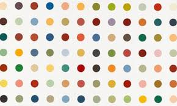

# Hirst Painting 🎨

A Python Turtle Graphics project that creates a colorful spot painting inspired by Damien Hirst's famous spot paintings.

## About the Project

This project uses Python's Turtle graphics to draw a grid of colorful dots. Each dot is assigned a randomly selected color, creating a unique artwork every time the program runs.

## Features

- Colorful spot patterns
- Randomly selected colors
- Turtle graphics
- Creative use of Python programming

## Technologies Used

- Python
- Turtle Graphics
- Random module

## Project Files

- `main.py` – Main painting program
- `colorful_circle.py` – Additional circle drawing program
- `img.png` – Project image
- `.gitignore` – Files excluded from Git tracking

## How to Run

1. Install Python.
2. Download or clone this repository.
3. Open the project folder.
4. Run:

```bash
python main.py
```

## Preview



## Author

Aziz Ullah is a Computer Science student learning Python and exploring creative programming.
